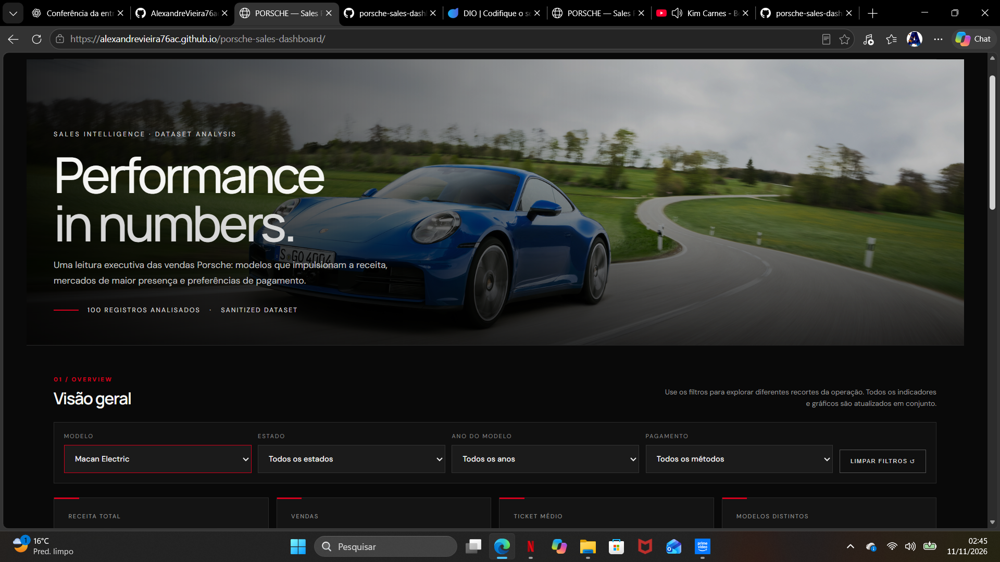
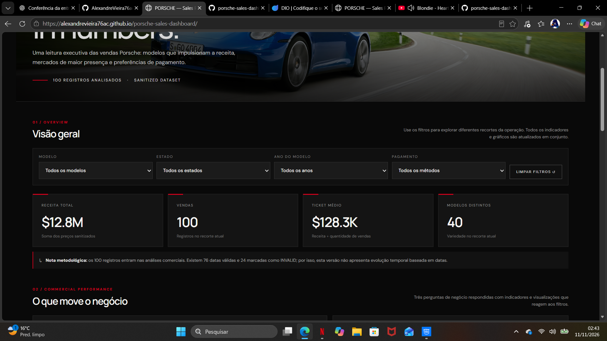

# Porsche Sales Performance Dashboard


Dashboard interativa para análise de desempenho comercial de vendas de veículos Porsche, desenvolvida como parte do desafio de projeto da **Digital Innovation One (DIO)**, utilizando inteligência artificial como apoio ao desenvolvimento.

**Acesse a dashboard publicada:**

[🚘 Porsche Sales Performance Dashboard](https://alexandrevieira76ac.github.io/porsche-sales-dashboard/)

**Repositório do projeto:**

[GitHub – porsche-sales-dashboard](https://github.com/alexandrevieira76ac/porsche-sales-dashboard)

---

## 1. Objetivo do projeto

O objetivo deste projeto é transformar uma base de dados de vendas Porsche em uma dashboard interativa, permitindo analisar indicadores comerciais, identificar padrões de vendas e apoiar a tomada de decisões estratégicas.

A proposta foi desenvolver uma solução visual com identidade inspirada no posicionamento premium da Porsche, combinando apresentação executiva, indicadores de desempenho e filtros interativos.

O projeto também teve como objetivo explorar o uso da inteligência artificial no desenvolvimento de soluções de análise de dados, desde a definição dos requisitos até a construção da aplicação.

## 2. Perguntas de negócio

Foram definidas três perguntas principais para orientar a análise:

### Pergunta 1 — Quais modelos Porsche geram maior receita?

**Objetivo:** identificar os modelos com maior participação no faturamento.

**Importância para o negócio:** compreender quais veículos apresentam maior contribuição comercial e identificar oportunidades relacionadas ao portfólio de produtos.

### Pergunta 2 — Quais estados apresentam maior volume de vendas?

**Objetivo:** analisar a distribuição geográfica das vendas e identificar os estados com maior concentração de negócios.

**Importância para o negócio:** compreender a distribuição da demanda e identificar possíveis oportunidades de expansão comercial.

### Pergunta 3 — Quais métodos de pagamento representam maior participação na receita?

**Objetivo:** analisar a participação dos diferentes métodos de pagamento no resultado comercial.

**Importância para o negócio:** compreender o comportamento de pagamento dos clientes e apoiar decisões relacionadas às estratégias comerciais.

As perguntas foram escolhidas considerando três dimensões fundamentais da análise comercial: desempenho dos produtos, distribuição geográfica e comportamento de pagamento.

## 3. Base de dados e preparação

A base utilizada no projeto contém informações comerciais de vendas de veículos Porsche.

Características identificadas na base:

| Característica | Quantidade |
|---|---:|
| Registros de vendas | 100 |
| Colunas | 21 |
| Modelos de veículos | 40 |
| Estados | 33 |
| Métodos de pagamento | 9 |
| Datas válidas identificadas | 76 |
| Datas inválidas identificadas | 24 |

### Tratamento e cuidados com os dados

A preparação da base considerou os seguintes cuidados:

- Seleção dos campos necessários para responder às perguntas de negócio.
- Verificação da consistência das informações utilizadas nos indicadores.
- Identificação de registros com datas inválidas.
- Preservação dos valores originais quando não havia informação suficiente para corrigir inconsistências.
- Utilização de uma versão sanitizada da base para a publicação.
- Verificação para evitar exposição de informações pessoais ou sensíveis.

Um ponto importante identificado foi a existência de 24 registros com datas classificadas como `INVALID`.

Esses registros exigem atenção em análises temporais, pois não devem ser interpretados como datas válidas nem utilizados para gerar conclusões incorretas.

A publicação utiliza dados destinados à demonstração analítica, sem necessidade de disponibilizar informações pessoais ou sensíveis.

## 4. Desenvolvimento com inteligência artificial

O ChatGPT foi utilizado como ferramenta de apoio ao desenvolvimento da dashboard, por meio da conversa normal, sem utilização do Canvas ou de agente com skill própria.

A inteligência artificial auxiliou na estruturação da solução, elaboração do código, organização dos indicadores, construção dos filtros e aprimoramento da apresentação visual.

### Prompt utilizado na construção

O prompt consolidado para orientar a construção da dashboard foi:

> Desenvolva uma dashboard interativa para análise de vendas de veículos Porsche, utilizando HTML5, CSS3 e JavaScript.
>
> A interface deve apresentar uma identidade visual premium, inspirada na Porsche, utilizando uma combinação de preto, grafite, branco e vermelho.
>
> A dashboard deve responder às seguintes perguntas de negócio:
>
> 1. Quais modelos Porsche geram maior receita?
> 2. Quais estados apresentam maior volume de vendas?
> 3. Quais métodos de pagamento representam maior participação na receita?
>
> Inclua indicadores KPI para apresentar o desempenho comercial e gráficos que permitam visualizar os resultados dessas análises.
>
> Implemente filtros interativos por modelo, estado, ano e método de pagamento, garantindo que todos os indicadores e gráficos sejam atualizados conforme as seleções realizadas.
>
> Inclua uma apresentação dos modelos Porsche com maior receita, valorizando a identidade visual dos veículos.
>
> A aplicação deve possuir layout responsivo, boa legibilidade, organização visual e navegação intuitiva.
>
> Desenvolva uma solução funcional diretamente no navegador, sem necessidade de backend.

### Evolução e refinamento do prompt

O desenvolvimento foi conduzido por etapas de refinamento dos requisitos:

**Etapa 1 — Estrutura analítica**

Definição das perguntas de negócio, indicadores e gráficos necessários para compreender o desempenho comercial.

**Etapa 2 — Identidade visual**

Refinamento da interface para adotar uma estética premium, inspirada na identidade visual da Porsche.

**Etapa 3 — Interatividade**

Inclusão dos filtros por modelo, estado, ano e método de pagamento, com atualização dos resultados apresentados.

**Etapa 4 — Experiência do usuário**

Aprimoramento da organização dos elementos, destaque dos modelos de maior receita e apresentação dos indicadores em uma estrutura executiva.

O prompt apresentado representa a consolidação dos requisitos do projeto, e não uma transcrição literal de todas as interações realizadas durante o desenvolvimento.

## 5. Funcionalidades da dashboard

A aplicação contempla:

- **4 filtros interativos:** modelo, estado, ano e método de pagamento.
- **4 indicadores KPI:** resumo do desempenho comercial.
- **3 gráficos analíticos:** visualização das principais dimensões de negócio.
- **Ranking de veículos:** destaque dos seis modelos com maior receita.
- **Atualização dinâmica:** indicadores e gráficos acompanham os filtros selecionados.
- **Interface responsiva:** adaptação da apresentação a diferentes tamanhos de tela.
- **Identidade visual premium:** cores e elementos inspirados no universo Porsche.

## 6. Tecnologias e ferramentas utilizadas

| Tecnologia ou ferramenta | Aplicação |
|---|---|
| HTML5 | Estrutura da dashboard |
| CSS3 | Estilização e identidade visual |
| JavaScript | Filtros, cálculos e interatividade |
| ChatGPT | Apoio à geração e ao refinamento do código |
| GitHub | Versionamento e armazenamento do projeto |
| GitHub Pages | Hospedagem e publicação da aplicação |

### Modalidade de utilização da IA

Foi utilizado o **ChatGPT em conversa normal (chat)**.

Não foi utilizado o Canvas nem um agente com skill própria.

O desenvolvimento foi realizado por meio de solicitações em linguagem natural, avaliação dos resultados gerados e refinamento progressivo dos requisitos.

## 7. Estrutura do projeto

O repositório está organizado da seguinte maneira:

```text
porsche-sales-dashboard/
│
├── index.html
│
└── README.md
```

O arquivo `index.html` concentra a aplicação da dashboard, incluindo sua estrutura, apresentação visual e funcionalidades.

O `README.md` documenta os objetivos, as perguntas de negócio, as tecnologias e as decisões tomadas durante o desenvolvimento.

## 8. Publicação no GitHub Pages

A dashboard foi publicada utilizando o GitHub Pages, permitindo seu acesso diretamente pelo navegador.

**Dashboard publicada:**

https://alexandrevieira76ac.github.io/porsche-sales-dashboard/

**Repositório público:**

https://github.com/alexandrevieira76ac/porsche-sales-dashboard

A publicação permite visualizar a aplicação sem necessidade de instalação de ferramentas ou configuração de ambiente local.

## 9. Evidências do projeto

A demonstração da dashboard publicada é parte importante da validação do projeto.

**Dashboard em funcionamento:**

[Visualizar aplicação no GitHub Pages](https://alexandrevieira76ac.github.io/porsche-sales-dashboard/)

**Evidências recomendadas para complementar o repositório:**

- Captura de tela da dashboard completa, mostrando os indicadores e gráficos.
- Captura de tela com filtros aplicados, demonstrando a atualização dos resultados.

As imagens devem ser adicionadas ao repositório somente depois de capturadas da aplicação real.

## 10. Aprendizados e conclusão

O desenvolvimento deste projeto proporcionou a aplicação prática de conhecimentos relacionados à análise de dados, visualização de informações e utilização de inteligência artificial no desenvolvimento de soluções digitais.

Entre os principais aprendizados estão:

- Transformação de dados em informações para o negócio.
- Definição de perguntas analíticas relevantes.
- Importância da qualidade e preparação dos dados.
- Engenharia de prompts e refinamento de requisitos.
- Construção de indicadores e gráficos interativos.
- Desenvolvimento de interfaces com HTML, CSS e JavaScript.
- Publicação de aplicações utilizando GitHub Pages.

O principal aprendizado foi compreender que uma dashboard eficiente não depende apenas de gráficos visualmente atraentes. É necessário entender o problema de negócio, preparar os dados corretamente e construir visualizações que ajudem a transformar informações em decisões.

---

**Projeto desenvolvido para fins educacionais como parte dos estudos na Digital Innovation One (DIO).**

**Desenvolvido com apoio do ChatGPT.**
## Evidências do Projeto

### 1. Dashboard com filtros aplicados



### 2. Dashboard sem filtros


